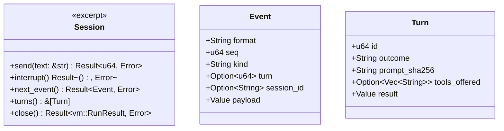

# Agent sessions

`agent::runtime` pins Claude Code, the self-contained TypeScript SDK entry
point and Node. `agent::layer` builds these files and the wrapper through
the same verified, atomic cache path as single-program layers.
`agent::session::Session` runs that layer in one unprivileged VM and owns
the live protocol. The engine need not implement SDK message handling.

Use `Session::start`, send input, consume partial events and a terminal
result, then send the next input. To interrupt, call `interrupt` and keep
reading until both its receipt and the result have arrived. Closing during
a turn records cancellation. `close_with` forwards final events while
joining the VM; `close` is the convenience variant without a callback.
Drop stops the VM and records an incomplete outcome. A turn's
`tools_offered` is what Claude's `init` event of that turn says it offers
the model, which can be fewer than the options' `tools`; a difference is
logged once as a warning.

The [wire contract](../contracts/kai-agent-session-1.md) and
[run record](../contracts/kai-agent-run-1.md) define limits and failures.
Both CLI commands use this implementation. No durable restart/resume,
plugin framework, dynamic tool-permission UI or financial policy lives
here. Provider keys, spending approval and budgets stay in the external
model proxy; the session receives only a validated placeholder or mock dummy.

The opt-in `session_vm` integration tests require a fetched runtime, KVM,
and an explicitly selected local mimic binary, one that answers `tool:`
(mimic 0.2.0). They cover multi-turn streaming, interruption/continuation,
active close, Drop and VM timeout, and tool calls the fake model makes:
Bash in the tree as uid 1000 with all six tools offered, a Write and an
Edit that come out with the tree, a permission request that is denied and
recorded, and a tool outside the allowlist that is not offered. One test
holds a tree's CLAUDE.md, AGENTS.md and hooks out of the session, which
the wrapper's empty setting sources do. They make no provider call.
Real-model qualification is separate.
