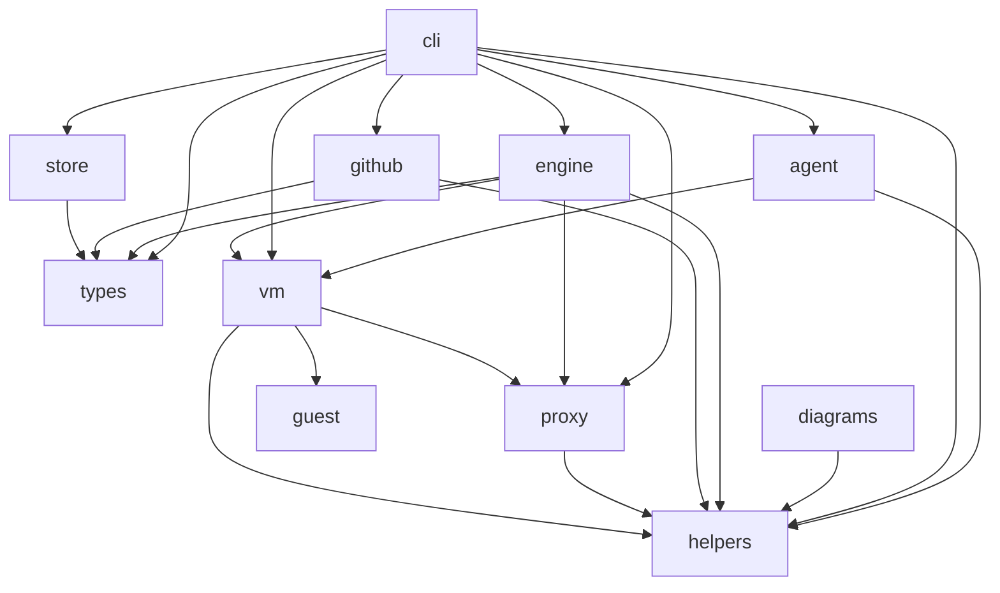

# The crates

Each box is a crate under `crates/`; an arrow is a `[dependencies]` entry
that names another of them. Dev-dependencies are not drawn. A test writes
the graph from the manifests and fails when it differs; after a change to
a manifest, `UPDATE_DIAGRAMS=1 cargo nextest run -p diagrams` writes it
again.

The same test holds these rules, whatever the graph says:

- `types` depends on no crate of kai's: the domain types are data only.
- `helpers` depends on no crate of kai's: it is infrastructure, beneath
  every crate that does what kai does.
- `guest` depends on no crate of kai's: kai's init is built alone, static,
  for the guest.
- No crate depends on `diagrams`: the diagram checks are a maintainer's
  tool, not part of the program `kai`.

`engine` never depends on `cli`, as `AGENTS.md` says; the compiler keeps
that one, since `cli` has no library.
