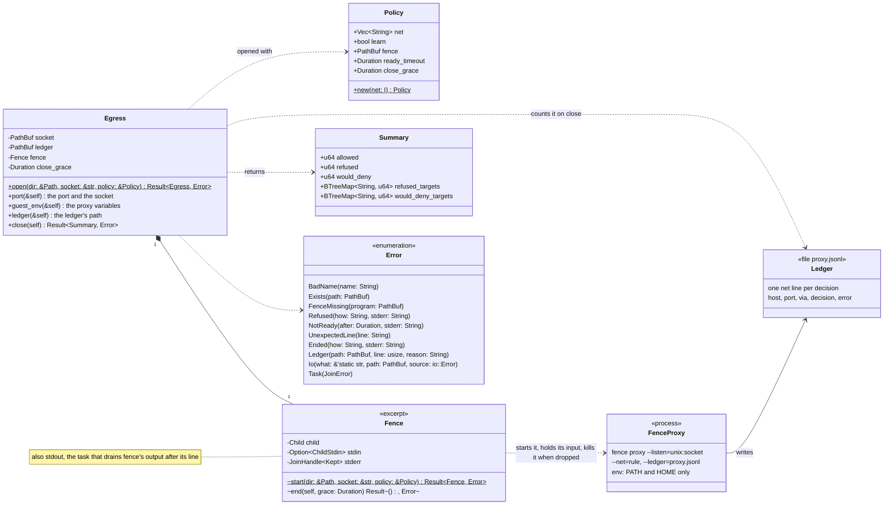

# A run's way out: `Egress`

`crates/proxy` gives a run's microVM its one way out. The runner opens an
`Egress` in the run's directory; behind it runs `fence proxy`, one child
process per run, on the socket the launcher's port ends at. Closing the
egress ends fence and counts its ledger. The crate's documentation says
what kai relies on in fence's behaviour.

## The types

Public items carry `+`, the crate's own `~`, private ones `-`. fence is a
process of its own, and its ledger a file; neither is a Rust type.

`Error`'s variants have named fields in Rust; the diagram writes them in
parentheses, since Mermaid cannot show braces inside a class. `Fence` is
an excerpt: Mermaid reads a member with parentheses as a method, so its
field `stdout: JoinHandle<()>` is named in the note instead.

## The life of an `Egress`

Every way fence can fail ends in an error that says how, with fence's own
words where it gave some. A ledger kai cannot read is an error, never a
count of 0.

```mermaid
%% shows every variant of proxy::Error
%% drawn from proxy::Egress::open#f406ee7d, proxy::Egress::close#89cdd8ce, proxy::fence::Fence::start#99d414bd, proxy::fence::Fence::end#a0ed361b
stateDiagram-v2
    state "Checking name, directory, files in the way" as Checking
    state "fence started, waiting for its line" as Starting
    state "Open: the VM may start" as Open
    state "Input closed, waiting for fence to end" as Closing
    state "Counting the ledger" as Counting
    state "Summary" as Done
    state "BadName, Exists or Io: nothing started" as NotStarted
    state "FenceMissing" as Missing
    state "Refused: fence's exit and its words" as Refused
    state "NotReady or UnexpectedLine: fence killed" as Killed
    state "Ended: fence's exit, or killed after the grace" as Ended
    state "Ledger: the line kai cannot read; Io: no ledger to read" as LedgerError
    state "Task: a reader of fence's output failed" as TaskFailed
    state "Dropped: fence killed, no summary" as Dropped

    [*] --> Checking
    Checking --> NotStarted : a check fails, or fence cannot be started
    Checking --> Missing : the program is not found
    Checking --> Starting : fence spawned
    Starting --> Open : listening unix socket
    Starting --> Refused : fence exits first
    Starting --> Killed : no line in time, or another line
    Starting --> TaskFailed
    Open --> Closing : close()
    Open --> Dropped : the Egress is dropped
    Closing --> Counting : fence exits with 0
    Closing --> Ended : another exit, or no end in time
    Closing --> TaskFailed
    Counting --> Done : every net line read
    Counting --> LedgerError : a line kai cannot read
    Done --> [*]
```

