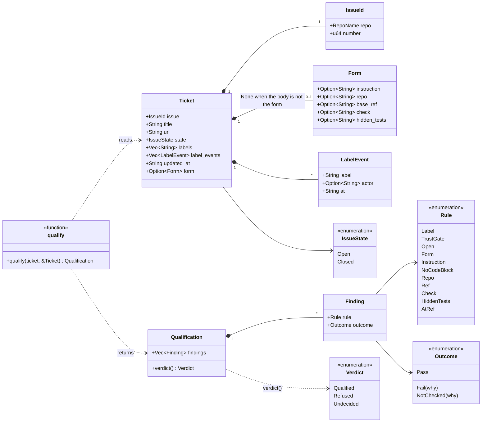
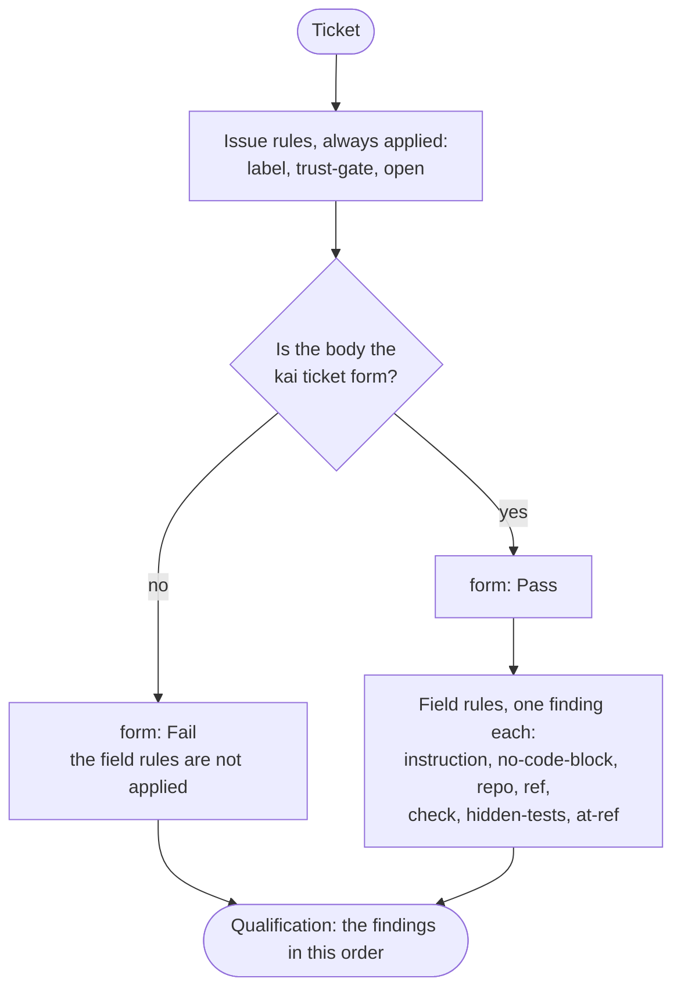

# Static qualification

`engine::qualify::qualify` decides from what GitHub said about a ticket
whether kai may use it. It is a pure function: no repository, no VM, no
model, no network. The types it reads and returns are in the crate
`types`.

## The types



A form field left empty is `None`; qualifying is what judges it. A
`Finding` is one rule applied to one ticket.

## What `qualify` does



| Rule | Pass when | Fail when | Not checked when |
| --- | --- | --- | --- |
| `label` | the issue has the label `kai` | it has not | |
| `trust-gate` | | | always, for now: who put the label on is not looked up |
| `open` | the issue is open | it is closed | |
| `form` | the body has the form's `### Instruction` heading | it has not | |
| `instruction` | the instruction is not blank | it is empty or blank | |
| `no-code-block` | no line of the instruction starts with ```` ``` ```` or `~~~` | one does: it may give the solution away | |
| `repo` | the repository is `owner/name` | it is missing or malformed | |
| `ref` | the ref is a full commit sha (40 hex digits) | it is missing, a branch, or short | |
| `check` | the ticket names a check | | it names none: the ecosystem's default is not detected yet |
| `hidden-tests` | the ticket names hidden tests | it names none | |
| `at-ref` | | | always, for now: the repository is not looked at |

## The verdict


A rule that was not checked is never counted as met. Since `trust-gate`
and `at-ref` are not checked for any ticket yet, every ticket is refused
or undecided; none is qualified until both are built.
