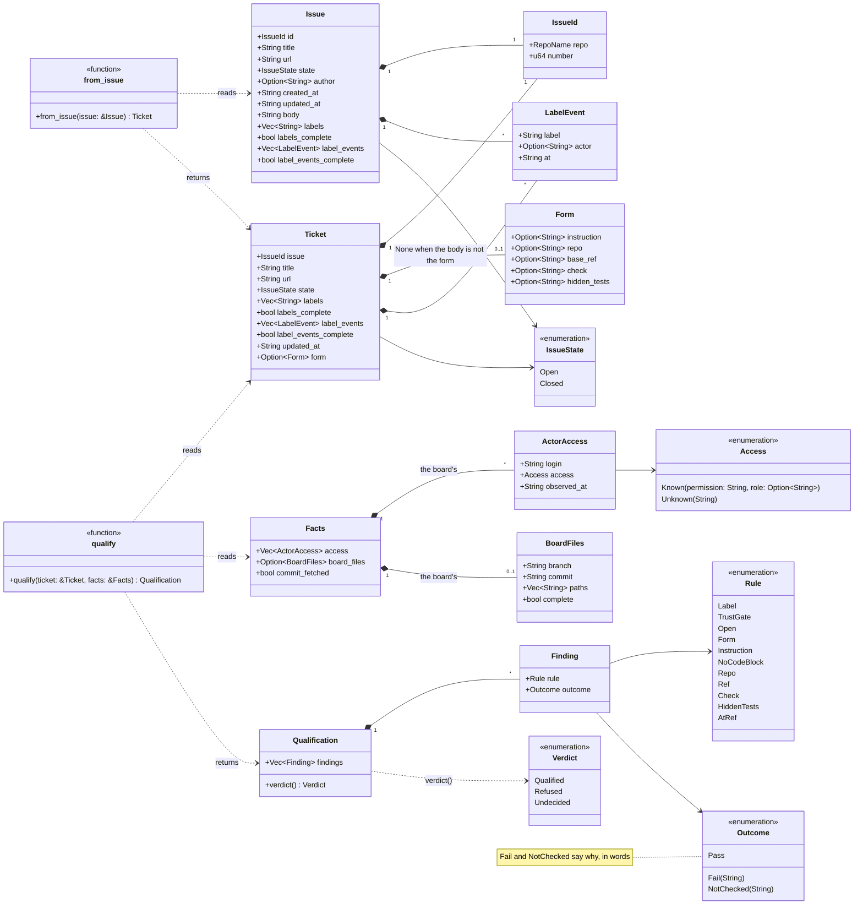
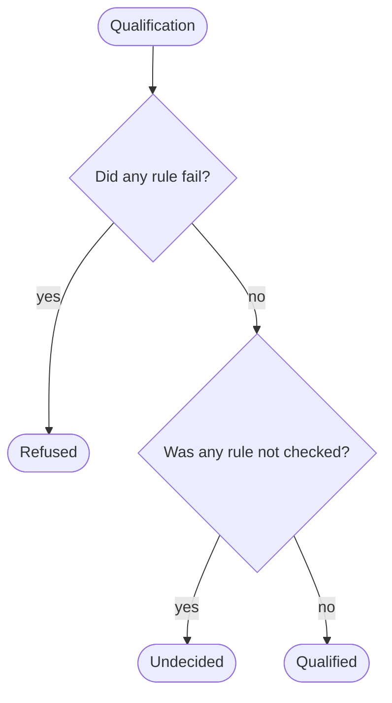

# Static qualification

`engine::qualify::qualify` decides from what GitHub said about a ticket
whether kai may use it. It is a pure function: no repository, no VM, no
model, no network. The types it reads and returns are in the crate
`types`, and what kai knows beside a ticket comes in as `Facts`. The store keeps an `Issue` as GitHub said it, body and all;
`engine::ticket::from_issue` reads its body as the kai ticket form and
makes the `Ticket` that `qualify` judges.

## The types



A form field left empty is `None`; qualifying is what judges it. A
`Finding` is one rule applied to one ticket. A sync fetches at most 100
labels and 100 labeled events of an issue; `labels_complete` and
`label_events_complete` say whether that was all of them, and when the
events are cut off, the latest are the ones missing.

## What `qualify` does


| Rule | Pass when | Fail when | Not checked when |
| --- | --- | --- | --- |
| `label` | the issue has the label `kai` | it has not, and every label was fetched | it has not among the 100 fetched, and it has more |
| `trust-gate` | the account that put `kai` on last has the role `admin`, `maintain` or `write` (else, without a role, the permission `admin` or `write`), as GitHub said when asked | it has another role (`triage`, `read`, …), or it no longer exists | the issue has no `kai` label; not every labeled event was fetched; no event that put `kai` on was fetched; that account's access was not asked, or GitHub did not tell it |
| `open` | the issue is open | it is closed | |
| `form` | the body has the form's `### Instruction` heading | it has not | |
| `instruction` | the instruction is not blank | it is empty or blank | |
| `no-code-block` | no line of the instruction starts with ```` ``` ```` or `~~~` | one does: it may give the solution away | |
| `repo` | the repository is `owner/name` | it is missing or malformed | |
| `ref` | the ref is a full commit sha (40 hex digits) | it is missing, a branch, or short | |
| `check` | the ticket names a check | | it names none: the ecosystem's default is not detected yet |
| `hidden-tests` | the ticket names hidden tests | it names none | |
| `at-ref` | a fetch run checked the ticket's commit out (`kai ticket deps` left its layer in the cache), and a file of the board matches the hidden tests: the path itself, a file under it, or a glob (`*` and `?` within a part, `**` across parts) | the code repository is the board itself; no file of a full listing of the board matches | the ticket names no repository, full ref or hidden tests; hidden tests given as a pull request; the board's files were never listed, or the listing was cut short and nothing matched; no fetch run checked the commit out |

## The verdict



A rule that was not checked is never counted as met. A ticket is
qualified only once kai knows everything beside it: the label actor's
access (`kai github sync --actor-permissions`), the board's files (every
`kai github sync`) and its commit fetched (`kai ticket deps`).

The hidden tests lie in the board repository, never in the code
repository: the agent works in a tree of the code repository and must
not see them. `at-ref` checks that they are there, not what they hold.

The trust gate judges the access the account has **when it was asked**,
not when it put the label on: an account that lost write access since
then fails, one that gained it passes. The last `kai` event counts, so
whoever puts the label on again after a maintainer is the one judged.

## How kai uses it

`kai github sync` fills the store with issues as GitHub said them; with
`--full` it also removes those GitHub no longer returns, and with
`--actor-permissions` it asks GitHub what access each account that put a
label on has to the board now, and keeps the answers: the data the trust
gate is judged on. Every sync also lists the board's files at the head of
its default branch, where the hidden tests lie; the token needs read
access to the board's contents for that, and where GitHub refuses, the
sync says so and keeps the listing of before. `kai ticket qualify`
reads the issues and what the store keeps of each board, looks in kai's
VM cache for a fetch layer of each ticket's commit, makes each issue a
ticket and judges it. Qualifying
needs no network: it works on what the last sync fetched, and `kai store
status` says when that was.

```mermaid
%% checked against crates/store, crates/github, crates/engine
%% drawn from cli::cmd::github::sync#bcbe5b9d, cli::cmd::ticket::print_qualify#a66f8c6f
sequenceDiagram
    actor You
    participant cli as kai (cli)
    participant gh as github::Client
    participant GitHub
    participant store as store::Store
    participant ticket as engine::ticket
    participant engine as engine::qualify

    You->>cli: kai github sync
    cli->>store: cursor(board)
    cli->>gh: fetch_board(board, since)
    gh->>GitHub: GraphQL, 50 issues a page
    GitHub-->>gh: issues, labels, labeled events
    gh-->>cli: issues and the next cursor
    cli->>store: record_sync(board, issues, cursor, full)
    opt --actor-permissions
        cli->>store: actors(board)
        loop each account that put a label on
            cli->>gh: access(board, login)
            gh->>GitHub: REST, the collaborator's permission
            gh-->>cli: Known, or Unknown with GitHub's words
        end
        cli->>store: record_access(board, answers)
    end
    cli->>gh: board_files(board)
    gh->>GitHub: GraphQL, the default branch's head; REST, its tree
    alt GitHub lists them
        gh-->>cli: BoardFiles
        cli->>store: record_board_files(board, files)
    else GitHub refuses
        Note over cli: says why; the listing of before stays
    end

    You->>cli: kai ticket qualify
    cli->>store: issues()
    store-->>cli: every issue
    cli->>store: access(board) and board_files(board), once per board
    store-->>cli: what GitHub said of the label actors and the files
    loop each issue
        cli->>ticket: from_issue(issue)
        ticket-->>cli: Ticket, the body read as the form
        Note over cli: commit_fetched: a fetch layer of the ticket's commit in the VM cache
        cli->>engine: qualify(ticket, facts)
        engine-->>cli: Qualification
        Note over cli: prints the verdict and each finding that did not pass
    end
    cli-->>You: how many are qualified, refused, undecided
```
